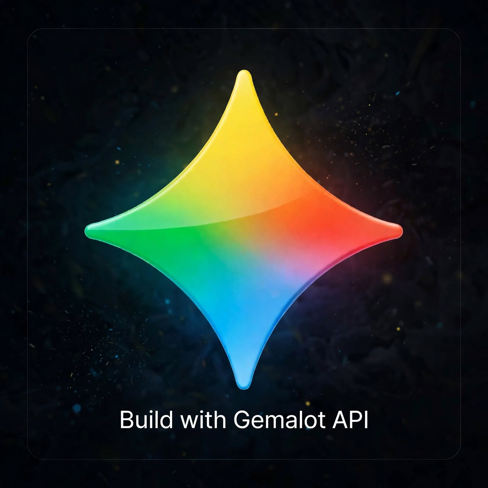

<!DOCTYPE html>
<html lang="ar" dir="rtl">
<head>
    <meta charset="UTF-8">
    <meta name="viewport" content="width=device-width, initial-scale=1.0">
    <title>Alislamiah API Studio</title>
    
</head>
<body>

    <!-- STAGE 0: Fullscreen Video -->
    

        <video id="intro-video" autoplay muted playsinline>
            <source src="intro.mp4" type="video/mp4">
        </video>
        <button id="continue-btn" onclick="goToHero()">Continue to Alislamiah API studio</button>
    

    <!-- STAGE 1: Hero / Landing -->
    

        

            
            

                
Build your models with Alislamiah API

                
Powerful • Fast • Ready for production

                <button class="start-btn" onclick="goToStudio()">Start project</button>
            

        

    

    <!-- STAGE 2: Studio (original logic) -->
    

        

            
Alislamiah API Studio

            <!-- Step 1: Project Name -->
            

                <h2>مشروع جديد</h2>
                <label>Project Name</label>
                <input type="text" id="projectName" placeholder="أدخل اسم المشروع">
                <button class="action-btn" onclick="nextStep()">Next</button>
            

            <!-- Step 2: Name Key -->
            

                <h2>إنشاء مفتاح API</h2>
                <label>Project ID</label>
                

                <label>Name your API Key</label>
                <input type="text" id="keyName" placeholder="أدخل اسم المفتاح">
                <button class="action-btn" onclick="generateKey()">توليد المفتاح وكود الاستدعاء</button>
            

            <!-- Step 3: Result -->
            

                <h2>تم إنشاء المفتاح بنجاح</h2>
                
100 رسالة مجانية

                <label>مفتاحك</label>
                

                <label>كود التثبيت والربط بـ Gemalot</label>
                

                <button class="action-btn" onclick="location.reload()" style="margin-top: 10px;">إنشاء مشروع آخر</button>
            

        

    

    
</body>
</html>
